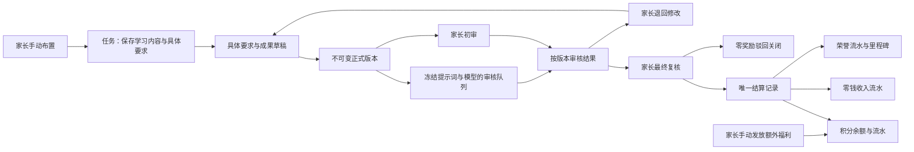

# 数据结构与业务约束

## 技术选择

Python 3.10+ / Django 5.2 LTS、Django 模板和少量原生 JavaScript；PostgreSQL 为生产数据库，SQLite IMMEDIATE 为本地开发数据库；私有文件系统存储，数据库只保存元数据与相对键。数据库持久队列避免另引入 Redis，worker 可以独立部署。

## 实体分组

| 领域 | 实体 | 关键约束 |
| --- | --- | --- |
| 身份 | User / ParentChild / Identity | issuer+subject 唯一；家长与孩子唯一；没有基于邮箱的自动合并 |
| 任务 | Subject / SubjectRule / TaskTemplate / Task | 由家长手动创建；旧 TaskTemplate 只保留历史关联，不再默认套用或自动生成任务 |
| 版本 | Submission / Review / ReviewJob / AIRun | task+number 唯一；每版本一个最终初审；每版本一个 AI 队列 |
| 复核 | FinalFeedback / Settlement | 退回反馈追加保存；每任务一个结算。source 区分 AI 自动完成与家长确认；AI 结算的 parent 为空 |
| 积分 | Wallet.points,frozen_points / PointEntry / Settlement.points | 英语任务真实 AI 通过或家长确认完成固定 +10，任务唯一流水；1 积分＝1 元，提现冻结积分，家长确认支付后扣减并记录负数流水，与荣誉和历史零钱分开 |
| 荣誉 | Wallet.honor / HonorEntry / Milestone / MilestoneAward | 荣誉流水独立；里程碑唯一发奖，兑现时间另存 |
| 零钱 | Wallet.balance,frozen / CashEntry / Withdrawal | 整数分；frozen≤balance；提现请求键唯一 |
| 额外福利 | ExtraBenefitGrant / PointEntry | 关联家长手动发放积分；请求键唯一；余额、记录与通知原子保存 |
| 历史福利 | Benefit / BenefitSelection / DailyAchievement / BenefitGrant | 原每日福利已停用，仅保留旧数据，待执行回调停止 |
| 资源 | Asset / Animation / SiteConfig | UUID 寻址；业务附件与站点素材分类；资源读取鉴权 |
| 分析 | AnalysisRecord | 关联孩子、提交、审核；独立条目可删除，不改历史审核 |
| 通知 | Notification | 首页展示后通过 POST 确认；编辑和普通浏览不确认 |

## 状态

业务阶段：`draft` 待提交，`waiting` 等待审核，`revision` 待修改，`passed` 达标待最终复核，`awarded` 已颁奖，`rejected` 已驳回。只有后两项关闭任务。

AI 队列：pending → running → done；临时异常可在三次总尝试内回到 pending，非临时错误/预算耗尽/异常中断交 parent。状态不会修改模板的 AI 设置，所以新版本不受前一版失败影响。

旧福利回调已停用；历史 pending 标为 expired，executing 标为 uncertain，不再执行外部请求。

## 锁与事务

所有影响孩子任务集合、钱包或奖励的操作统一先锁孩子用户行，再锁钱包行，然后锁任务或提现行。提交、初审写回、家长复核、提现申请/处理、额外福利发放均在事务内执行。数据库唯一约束作为最后防线。提现并发争用同一个钱包，不先读余额再异步扣款。

正式结算需包含家长页面看到的 version_id。新版本产生后，旧页面复核被拒绝。旧版 AI 完成仍可追加该版本的审核和分析，但不会覆盖当前阶段。家长退回后延迟返回的 AI 也不能覆盖退回状态。

## 可运行与未验收边界

代码和迁移可本地执行，默认 mock。当前开发环境只安装了 Python 依赖，未提供 PostgreSQL 服务、Docker、LibreOffice 或浏览器自动化工具。SQLite 测试与 Django 测试客户端可以验证服务和页面响应，不能代替真实浏览器视觉检查或 PostgreSQL 并发验收。PostgreSQL 专用并发测试有条件执行，目标部署时必须运行。真实 AI、OIDC、办公格式转换与外部回调需要目标环境联调。

可选多通道额度/费用策略没有实现。旧格式办公文档在安装 LibreOffice 并使用多模态适配器时转换；普通兼容适配器对无法辨认材料转交家长。没有自动在线付款或设备控制。生产应使用 HTTPS、数据库和私有资源备份、出站网络防护、队列监控及日志保留策略。
